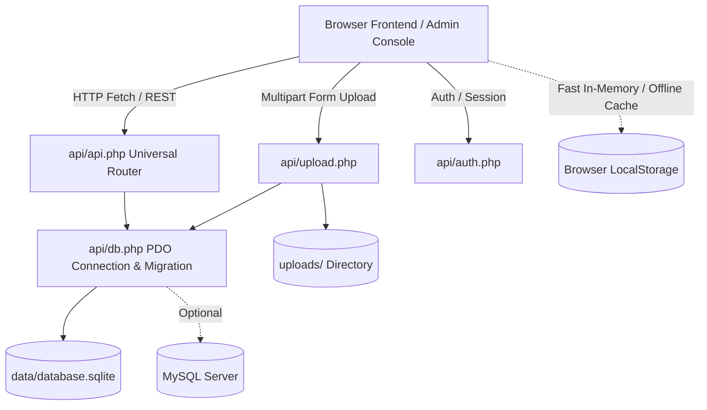

# CAEA PHP Database Backend Architecture & REST API (`api/`)

This document details the server-side PHP database engine, SQLite/MySQL storage layers, RESTful API endpoints, secure file/video uploader, and frontend synchronization mechanism.

---

## 1. Overview & Architecture

The CAEA platform features a server-side **PHP backend** with **PDO SQLite** (zero-configuration, self-contained single file in `data/database.sqlite`) and optional **MySQL/MariaDB** support.



### Key Advantages:
1. **Zero Setup Required**: Uses PDO SQLite by default. Creating or configuring a separate database server is not required.
2. **Server-Side Video & High-Res Image Uploads**: Directly stores images (`.jpg`, `.png`, `.webp`, `.svg`) and full video files (`.mp4`, `.webm`, `.mov`) into `uploads/`, avoiding browser localStorage size limits.
3. **Dual-Mode Client Integration**: `data-store.js` automatically detects server availability. When connected to PHP, mutations and queries synchronize with SQLite in real time while maintaining instant local cache responsiveness and offline fallback.
4. **Hardened Security**:
   - `data/.htaccess` blocks direct web downloads of SQLite databases and SQL dumps.
   - `uploads/.htaccess` disables script and PHP execution inside user upload directories.
   - `api/auth.php` verifies administrative SHA-256 hashes and enforces IP/session rate-limiting with 60-second lockouts after 5 consecutive failed attempts.

---

## 2. Directory Structure

```
CAEA/
├── api/
│   ├── .htaccess             # CORS headers & rewrite routing
│   ├── config.php            # Environment settings, database constants, paths, hashes
│   ├── db.php                # PDO connection manager, schema initialization & seed logic
│   ├── api.php               # Universal REST API controller (CRUD + bulk operations)
│   ├── upload.php            # Multipart image/video upload handler & media registry
│   ├── auth.php              # Session-based authentication & lockout control
│   └── seed.sql              # Standalone SQL schema and seed dump
├── data/
│   ├── .htaccess             # Denies direct HTTP access to database files
│   └── database.sqlite       # SQLite database (auto-generated on first run)
├── uploads/
│   ├── .htaccess             # Prevents PHP/script execution in upload folders
│   └── (user uploaded media) # Stored photos and MP4/WebM videos
├── data-store.js             # Client-side data store bridging REST API & localStorage
├── script.js                 # Public website interactive scripts
└── admin/                    # Administrative dashboard
```

---

## 3. Database Schema

All 11 collections are defined with strongly-typed schemas:

### 3.1 `activities`
- `id` (VARCHAR 64, PK)
- `title` (VARCHAR 255, NOT NULL)
- `category` (VARCHAR 64, NOT NULL)
- `date` (DATE, NOT NULL)
- `dateFormatted` (VARCHAR 32, NOT NULL)
- `location` (VARCHAR 255)
- `description` (TEXT)
- `image` (VARCHAR 512)
- `featured` (INTEGER DEFAULT 0)
- `quote` (TEXT)
- `quoteAuthor` (VARCHAR 255)
- `createdAt` (DATETIME)
- `updatedAt` (DATETIME)

### 3.2 `people`
- `id` (VARCHAR 64, PK)
- `name` (VARCHAR 255, NOT NULL)
- `role` (VARCHAR 255, NOT NULL)
- `category` (VARCHAR 64, NOT NULL)
- `bio` (TEXT)
- `image` (VARCHAR 512)
- `email` (VARCHAR 255)
- `createdAt` (DATETIME)
- `updatedAt` (DATETIME)

### 3.3 `articles`
- `id` (VARCHAR 64, PK)
- `title` (VARCHAR 255, NOT NULL)
- `subtitle` (VARCHAR 255)
- `kicker` (VARCHAR 64 DEFAULT 'CASE STUDY')
- `author` (VARCHAR 255, NOT NULL)
- `date` (DATE, NOT NULL)
- `dateFormatted` (VARCHAR 32, NOT NULL)
- `excerpt` (TEXT)
- `content` (TEXT)
- `image` (VARCHAR 512)
- `createdAt` (DATETIME)
- `updatedAt` (DATETIME)

### 3.4 `opportunities`
- `id` (VARCHAR 64, PK)
- `title` (VARCHAR 255, NOT NULL)
- `subtitle` (VARCHAR 255 NOT NULL)
- `category` (VARCHAR 255 NOT NULL)
- `type` (VARCHAR 64 NOT NULL)
- `theme` (VARCHAR 32 DEFAULT 'blue')
- `description` (TEXT)
- `status` (VARCHAR 32 DEFAULT 'Open')
- `image` (VARCHAR 512)
- `gridArea` (VARCHAR 32)
- `createdAt` (DATETIME)
- `updatedAt` (DATETIME)

### 3.5 `applications`
- `id` (VARCHAR 64, PK)
- `fullName` (VARCHAR 255 NOT NULL)
- `email` (VARCHAR 255 NOT NULL)
- `phone` (VARCHAR 64 NOT NULL)
- `city` (VARCHAR 255 NOT NULL)
- `opportunityId` (VARCHAR 64)
- `opportunityTitle` (VARCHAR 255)
- `category` (VARCHAR 255)
- `commitment` (VARCHAR 64)
- `message` (TEXT)
- `experience` (TEXT)
- `status` (VARCHAR 32 DEFAULT 'Pending')
- `date` (DATE NOT NULL)
- `dateFormatted` (VARCHAR 32 NOT NULL)
- `notes` (TEXT)
- `createdAt` (DATETIME)
- `updatedAt` (DATETIME)

### 3.6 `media`
- `id` (VARCHAR 64, PK)
- `title` (VARCHAR 255 NOT NULL)
- `category` (VARCHAR 64 NOT NULL)
- `path` (VARCHAR 512 NOT NULL)
- `tags` (TEXT)
- `date` (DATE)
- `createdAt` (DATETIME)

### 3.7 `map_pins`
- `id` (VARCHAR 64, PK)
- `city` (VARCHAR 255 NOT NULL)
- `leftPos` (VARCHAR 32 NOT NULL)
- `topPos` (VARCHAR 32 NOT NULL)
- `badge` (VARCHAR 255 NOT NULL)
- `description` (TEXT)
- `createdAt` (DATETIME)
- `updatedAt` (DATETIME)

### 3.8 `fossil_article_links`
- `id` (VARCHAR 64, PK)
- `title` (VARCHAR 255 NOT NULL)
- `publisher` (VARCHAR 255 NOT NULL)
- `badge` (VARCHAR 64 DEFAULT 'ARTICLE')
- `url` (VARCHAR 512 NOT NULL)
- `description` (TEXT)
- `sortOrder` (INTEGER DEFAULT 0)
- `createdAt` (DATETIME)
- `updatedAt` (DATETIME)

### 3.9 `climate_article_links`
- `id` (VARCHAR 64, PK)
- `title` (VARCHAR 255 NOT NULL)
- `publisher` (VARCHAR 255 NOT NULL)
- `badge` (VARCHAR 64 DEFAULT 'ARTICLE')
- `url` (VARCHAR 512 NOT NULL)
- `description` (TEXT)
- `sortOrder` (INTEGER DEFAULT 0)
- `createdAt` (DATETIME)
- `updatedAt` (DATETIME)

### 3.10 `textile_cards`
- `id` (VARCHAR 64, PK)
- `title` (VARCHAR 255 NOT NULL)
- `description` (TEXT)
- `category` (VARCHAR 64 DEFAULT 'WATER')
- `tag` (VARCHAR 64 DEFAULT 'water')
- `btnText` (VARCHAR 64 DEFAULT 'WATCH NOW')
- `targetOpportunity` (VARCHAR 255 DEFAULT 'Textile Watch')
- `videoUrl` (TEXT)
- `image` (VARCHAR 512)
- `sortOrder` (INTEGER DEFAULT 0)
- `createdAt` (DATETIME)
- `updatedAt` (DATETIME)

### 3.11 `page_settings`
- `pageKey` (VARCHAR 64, PK) — e.g. `'home'`, `'activities'`, `'ourStory'`, `'ourWork'`
- `settingsJson` (TEXT NOT NULL) — JSON encoded page configuration
- `updatedAt` (DATETIME)

---

## 4. REST API Reference (`api/api.php`)

All responses return standard JSON format: `{ "success": true, "data": ... }`.

### 4.1 System & Maintenance Endpoints
- **Status Check**: `GET /api/api.php?action=status`
  - Returns backend health, database driver, record counts across all collections.
- **Full Database Export**: `GET /api/api.php?action=export`
  - Returns JSON payload containing all tables and unpacked page settings.
- **Full Database Import**: `POST /api/api.php?action=import`
  - Body: `{ "data": { "activities": [...], "people": [...], "textile_cards": [...], ... } }`
- **Factory Reset**: `POST /api/api.php?action=reset`
  - Resets database back to default seed data.

### 4.2 Collection CRUD Operations

| Action | Method | URL | Body / Notes |
| :--- | :--- | :--- | :--- |
| **List All** | `GET` | `/api/api.php?collection={name}` | Supports filter params (e.g. `?category=WATER&limit=10`) |
| **Get by ID** | `GET` | `/api/api.php?collection={name}&id={id}` | Returns single record object |
| **Create** | `POST` | `/api/api.php?collection={name}` | JSON payload with item attributes |
| **Update** | `POST` / `PUT` | `/api/api.php?collection={name}&id={id}` | JSON payload with updated fields (or `action=update`) |
| **Delete** | `POST` / `DELETE` | `/api/api.php?collection={name}&id={id}` | Deletes record (or `action=delete`) |

*Valid collections*: `activities`, `people`, `articles`, `fossil_article_links`, `climate_article_links`, `textile_cards`, `opportunities`, `applications`, `media`, `map_pins`, `page_settings`.

---

## 5. Media Upload Handler (`api/upload.php`)

Accepts `POST multipart/form-data`:
- **Files accepted**:
  - Images: `.jpg`, `.jpeg`, `.png`, `.webp`, `.svg`, `.gif`, `.avif`
  - Videos: `.mp4`, `.webm`, `.mov`, `.ogv`
  - Documents: `.pdf`
- **Max file size**: 50MB
- **Parameters**: `file` (file binary), optional `title`, `category`, `tags`.
- **Response**:
```json
{
  "success": true,
  "message": "File uploaded successfully",
  "file": {
    "id": "med-1727201234-567",
    "name": "workshop_highlight_20260924_1234.mp4",
    "path": "uploads/workshop_highlight_20260924_1234.mp4",
    "url": "/uploads/workshop_highlight_20260924_1234.mp4",
    "mime": "video/mp4",
    "size": 15420312,
    "category": "Video",
    "title": "Workshop Highlight"
  }
}
```

---

## 6. Authentication API (`api/auth.php`)

- **Check Session**: `GET /api/auth.php?action=check`
- **Login**: `POST /api/auth.php?action=login`
  - Body: `{ "passcode": "CAEA@Admin#2026!" }` or `{ "passhash": "0bd52dc..." }`
- **Logout**: `POST /api/auth.php?action=logout`

---

## 7. Configuration & MySQL Switching (`api/config.php`)

To switch from SQLite to an external MySQL server, modify `api/config.php`:
```php
define('DB_DRIVER', 'mysql');
define('DB_HOST', '127.0.0.1');
define('DB_PORT', '3306');
define('DB_NAME', 'caea_db');
define('DB_USER', 'caea_user');
define('DB_PASS', 'secure_password');
```
Tables and default seed data are automatically initialized on the first connection.
